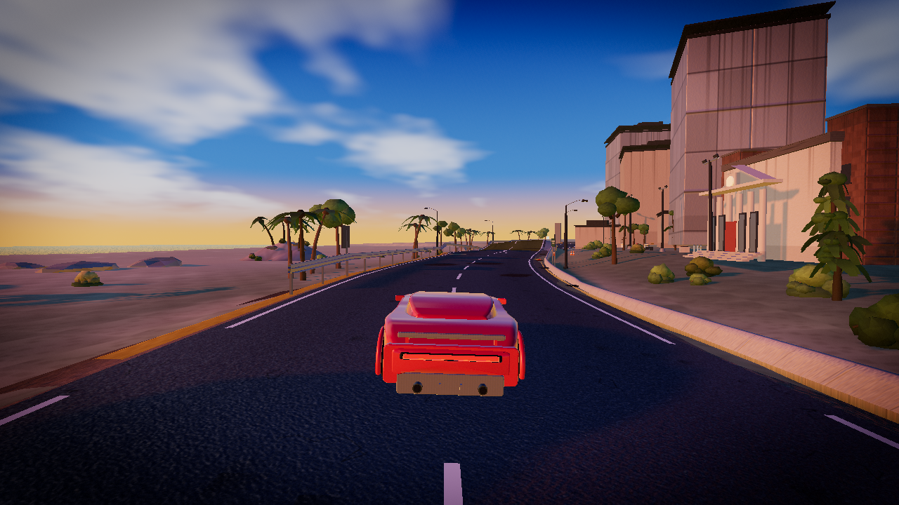
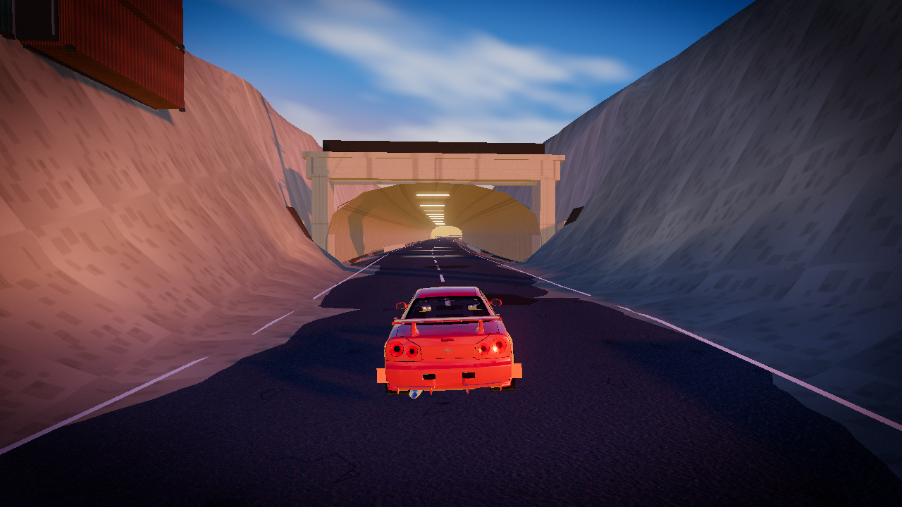
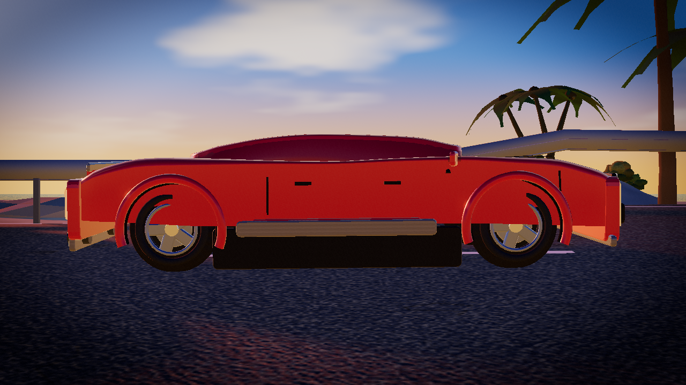
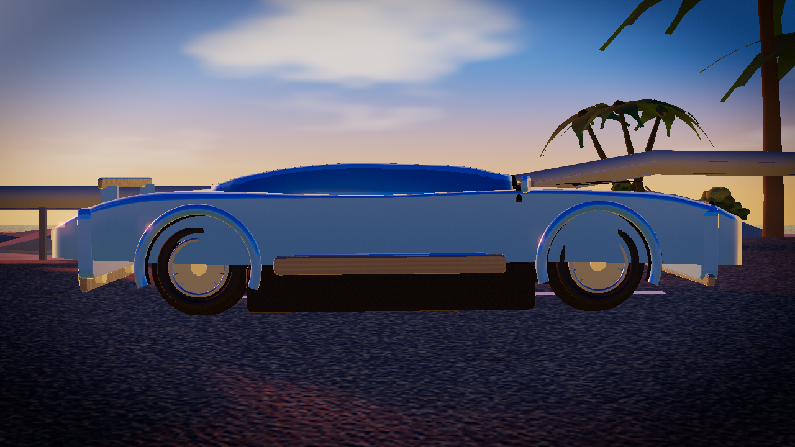
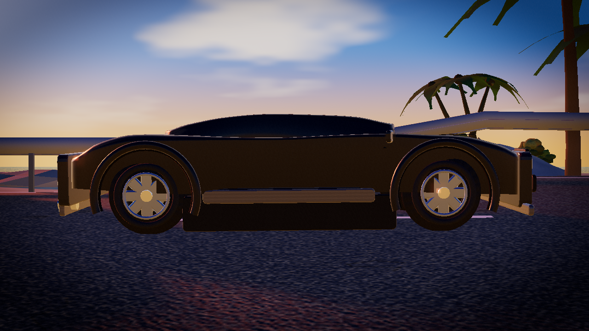
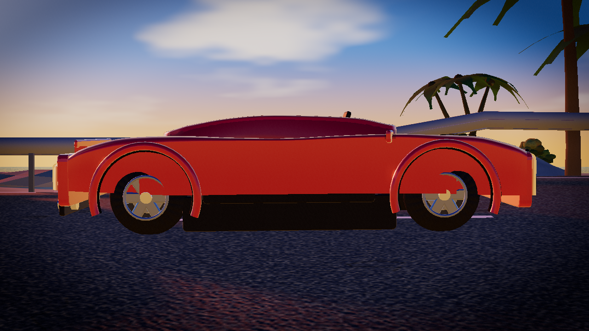

# Velocity Rush

A 3D arcade racing browser game: one track, four selectable cars, a six-car
field. Pick a model and paint in the garage, then race the AI field to the top
of the standings. It targets 60 FPS with keyboard and gamepad input,
deterministic visual evidence, and an open-source contribution policy that
ties new code to Qwen3.8-flash-next.






## Controls

| Action | Keyboard | Gamepad |
|---|---|---|
| Throttle | `W` or `↑` | Right trigger |
| Brake/reverse | `S` or `↓` | Left trigger |
| Steer | `A`/`←` and `D`/`→` | Left stick or d-pad |
| Handbrake | `Space` | LB |
| Nitro | `Shift` | RB |
| Respawn | `R` | Y |
| Pause | `P` or `Escape` | Start |
| Confirm | `Enter` | A |

On the title screen, navigate the garage with clicks or `Tab` + `Enter`.

## Cars & garage

Three authored silhouettes plus kit gating (wings, splitters, scoop, wide
track) produce four models, each with its own wheel style, signature finish,
and a clamped stat tuning (±40% over the shipped vehicle base):

| Model | Class | Character |
|---|---|---|
| Velocity GT | Balanced | The all-rounder baseline |
| Solaris Hyper | Top speed | Fastest straight line, more to manage in corners |
| Apex Grip | Corner grip | Hooks up mid-corner, trades terminal speed |
| Slide King | Drift | Loose and playful on the handbrake |

Each model ships a realistic finish: clearcoat paint with metallic flake and
per-model micro-roughness breakup, environment reflections, smoked tinted
glass, procedural carbon trim, brake discs and calipers, tire sidewalls, and
LED daytime-running/tail lamps.






Garage behaviour:

- Model cards show live stat bars; selection persists between sessions.
- Paint swatches recolour the player car; AI cars are re-coloured to avoid
  colliding with your pick.
- Cards lock once the countdown starts; abandoning via MAIN MENU unlocks them
  and parks the AI field.
- The AI field runs mixed models, and the standings name each car's model.

## Quickstart

```bash
npm ci
npm run dev
```

Open the Vite URL printed by the development server.

## Validation

Run every gate before requesting review:

```bash
npm run test
npm run typecheck
npm run build
npm run noleak
npm run functional
npm run shots
npm run audit
```

`npm run test` is the headless node suite; `npm run typecheck` compiles both
`src` and `tests`. The functional command boots the built harness in headless
Chromium and asserts real-DOM behaviours (garage clicks, keyboard confirms,
wheel transforms, field parking). It is intentionally CPU/SwiftShader-
compatible and skips wall-clock timing gates that require a real GPU. GPU
performance evidence is collected separately with:

```bash
node scripts/perf.mjs --mode ladder --gpu --label review
node scripts/perf.mjs --mode tiers --gpu --label tiers
```

The committed `shots/` battery is the visual acceptance evidence. Maintainers
still perform manual audio-listening, physical gamepad-feel, and 5-Second
gameplay reviews before accepting a user-visible change.

## Tech stack

- Vite
- TypeScript strict mode
- Three.js `0.168.x`
- WebGL2
- Node.js test and validation harnesses
- Playwright/Chromium for deterministic screenshot capture

## Repository layout

```text
src/               game code
tests/             headless tests
scripts/         validation harnesses
shots/             committed visual battery
docs/            design and implementation documents
.github/        issue/PR templates and workflows
```

## Contributing

Read [CONTRIBUTING.md](CONTRIBUTING.md) before starting work.

New code, tests, workflows, package metadata, and assets must be authored with
`Qwen3.8-flash-next`. Documentation-only contributions can use the docs-only
declaration instead. The pull-request attestation is self-reported; maintainers
verify the declaration against the changed files and commit evidence. Existing
commit history is grandfathered under this policy.

## License

Velocity Rush is released under the [MIT License](LICENSE).
